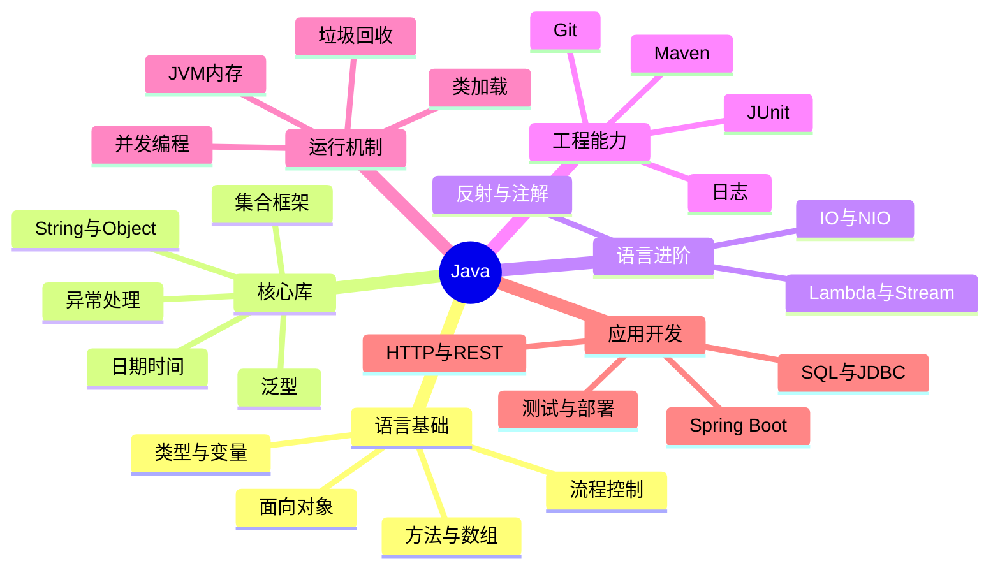

# Java 学习手册

本手册是仓库导航页。建议结合根目录 README 和 [学习路线](../RoadMap/学习路线.md) 使用。

## 专题目录

### 语言基础

- [01｜Java 基础语法](../Topics/01-Java基础语法.md)
- [02｜面向对象](../Topics/02-面向对象.md)
- [03｜集合与泛型](../Topics/03-集合与泛型.md)
- [13｜HashMap 底层原理与源码分析](../Topics/13-HashMap底层原理与源码分析.md)
- [14｜ArrayList 与集合源码阅读](../Topics/14-ArrayList与集合源码.md)
- [04｜异常与资源管理](../Topics/04-异常与资源管理.md)
- [05｜Lambda 与 Stream](../Topics/05-Lambda与Stream.md)

### 运行机制与进阶

- [06｜JVM 与内存](../Topics/06-JVM与内存.md)
- [07｜并发编程](../Topics/07-并发编程.md)
- [15｜线程池设计与任务治理](../Topics/15-线程池设计与任务治理.md)
- [08｜IO、NIO 与网络](../Topics/08-IO-NIO与网络.md)
- [09｜SQL 与 JDBC](../Topics/09-SQL与JDBC.md)
- [10｜Maven 与测试](../Topics/10-Maven与测试.md)

### 应用开发与面试

- [11｜Spring Boot 入门](../Topics/11-SpringBoot入门.md)
- [12｜Java 面试自测](../Topics/12-Java面试自测.md)
- [学习进度表](../RoadMap/学习进度.md)

## 知识地图

## 专题学习模板

每个专题建议按以下结构沉淀：

1. **问题与场景**：这个知识解决什么问题？
2. **核心概念**：用自己的话解释关键术语。
3. **运行机制**：必要时用 Mermaid 表示流程、生命周期或对象关系。
4. **最小示例**：提供可复制运行的代码，并写明 JDK 版本。
5. **常见误区**：列出容易写错或理解错的地方。
6. **练习**：至少一道基础题、一道人为构造的边界题。
7. **面试自测**：先回答，再对照资料查漏补缺。
8. **延伸阅读**：优先链接官方文档。

## 官方资料

- [Java Documentation](https://docs.oracle.com/en/java/)
- [Java Language Specification](https://docs.oracle.com/javase/specs/)
- [Dev.java 学习资源](https://dev.java/learn/)
- [Maven 官方指南](https://maven.apache.org/guides/)
- [JUnit 5 用户指南](https://junit.org/junit5/docs/current/user-guide/)
- [Spring Boot 文档](https://docs.spring.io/spring-boot/index.html)

## 学习原则

- 不把“看过”当作“掌握”。
- 优先写最小可复现示例，减少一次引入过多概念。
- 涉及版本差异时注明 JDK / 框架版本。
- 代码示例避免硬编码密码、令牌和个人数据。
- 不只记录结论，也记录结论成立的条件和例外。
