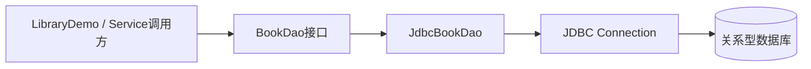

# JDBC 图书管理练习项目

本项目以 **JDK 17 + Maven + JDBC + H2（测试数据库）+ JUnit 5** 为基线，练习关系型数据库 CRUD、DAO 分层、参数化 SQL、资源管理与自动化测试。

## 运行

```bash
mvn test
mvn -q package
mvn -q exec:java -Dexec.mainClass="cn.ilikui.library.LibraryDemo"
```

在该目录执行以上命令。首次运行需要 Maven 下载依赖。

## 结构



- `Book`：不可变领域对象，构造时验证标题、作者和价格。
- `BookDao`：定义新增、按 ID 查询、列表、更新和删除契约。
- `JdbcBookDao`：使用 `PreparedStatement`，通过 try-with-resources 关闭语句与结果集。
- `LibraryDemo`：使用 H2 内存数据库演示基本调用。
- `JdbcBookDaoTest`：覆盖 CRUD、文本参数和非法数据。

## 重要说明

- H2 仅用于轻量练习与测试；生产项目应根据目标数据库调整驱动、DDL、分页和 SQL 方言。
- DAO 接收外部传入的 `Connection`，因此连接生命周期由调用方管理。本项目暂不包含连接池和事务服务层。
- 多条 SQL 需要组成一个原子业务操作时，应在 Service 层显式管理事务：保存原始 `autoCommit` 状态，关闭自动提交，成功后提交，异常时回滚，并在 `finally` 恢复状态。
- SQL 参数使用 `PreparedStatement` 绑定，不能通过字符串拼接用户输入构造 SQL。

## 后续练习

1. 增加 `BookService`，实现借书与归还的事务边界。
2. 增加库存字段与唯一约束，覆盖并发借阅。
3. 将 H2 换为目标数据库，并配置连接池。
4. 为 DAO 增加分页、标题模糊查询与排序白名单。
5. 为事务回滚编写测试，验证中途失败不会留下部分写入。