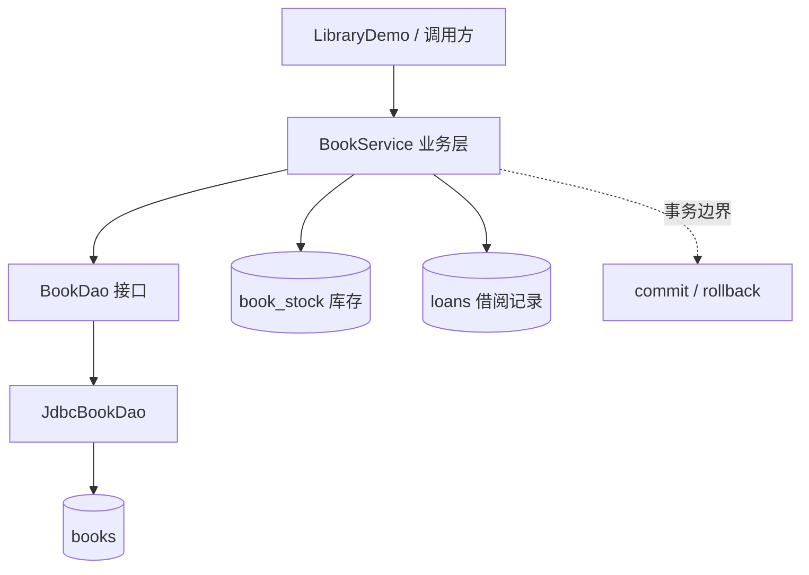

# JDBC 图书管理练习项目

本项目以 **JDK 17 + Maven + JDBC + H2（测试数据库）+ JUnit 5** 为基线，练习关系型数据库 CRUD、DAO 分层、事务与自动化测试。

## 运行

```bash
mvn test
mvn -q package
mvn -q exec:java -Dexec.mainClass="cn.ilikui.library.LibraryDemo"
```

请在本目录执行命令。首次运行需要 Maven 下载依赖。

## 架构



## 核心文件

- `Book`：不可变领域对象，验证标题、作者和价格。
- `BookDao`：定义图书新增、按 ID 查询、列表、更新与删除。
- `JdbcBookDao`：参数化 SQL 与 CRUD 实现。
- `BookService`：注册图书、借阅、归还、库存查询；多条 SQL 在同一事务内提交或回滚。
- `LibraryDemo`：演示基本 DAO 调用。
- `JdbcBookDaoTest`：覆盖 CRUD、文本参数和非法数据。
- `BookServiceTest`：覆盖借阅、库存耗尽、归还、重复归还与失败场景。

## 事务与并发注意事项

- 借阅通过条件更新 `available_count = available_count - 1 WHERE available_count > 0` 防止库存减成负数，再写入借阅记录；任一步失败会回滚。
- 归还只允许将尚未归还的借阅记录标记为已归还，并在同一事务增加库存，避免重复归还重复加库存。
- 当前事务工具适合演示单连接、单线程使用方式；同一个 `Connection` 不应被多个线程共享。并发测试应使用独立连接，并根据数据库隔离级别、锁行为与约束验证结果。
- H2 用于练习；生产环境需使用目标数据库、连接池、迁移工具，并明确事务恢复失败时的连接淘汰策略。

## 后续练习

1. 为借阅增加到期时间、借阅人编号与借阅历史查询。
2. 添加库存变更审计表，记录操作人、前后库存和原因。
3. 使用独立连接做并发借阅测试，确认库存为 1 时只允许一笔借阅成功。
4. 将业务接口迁移为 Spring Boot REST API，并为 Service 编写集成测试。