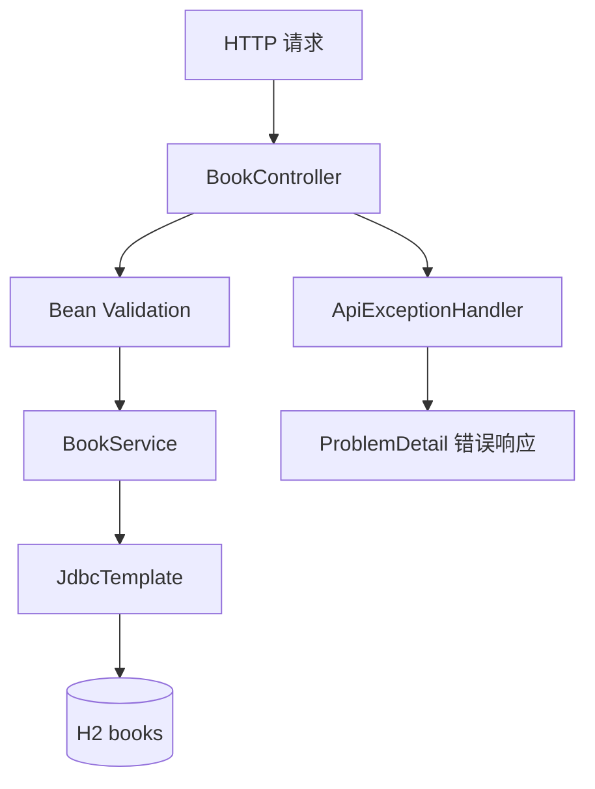

# Spring Boot 图书 REST API

新增独立的 Spring Boot 模块，练习 REST 接口、参数校验、JDBC 持久化、事务边界、统一异常响应与 MockMvc 集成测试。不会改动现有的 JDBC 项目。

## 技术栈

- JDK 17
- Spring Boot 3.4.4
- Spring Web、Bean Validation、Spring JDBC
- H2 内存数据库
- JUnit 5 + MockMvc

## 启动与测试

在本目录执行：

```bash
mvn test
mvn package
mvn spring-boot:run
```

服务默认监听 `http://localhost:8080`。数据库为内存库，应用重启后数据会重置；仅用于学习，不是生产数据存储方案。

## API 清单

| 方法 | 路径 | 说明 | 成功状态 |
|---|---|---|---|
| GET | `/api/books` | 查询全部图书 | 200 |
| GET | `/api/books/{id}` | 查询单本图书 | 200 |
| POST | `/api/books` | 新增图书 | 201 |
| PUT | `/api/books/{id}` | 更新图书 | 200 |
| DELETE | `/api/books/{id}` | 删除图书 | 204 |

新增/更新 JSON 示例：

```json
{
  "title": "Java 实战",
  "author": "张三",
  "price": 59.90
}
```

## 请求示例

```bash
curl http://localhost:8080/api/books

curl -X POST http://localhost:8080/api/books \
  -H "Content-Type: application/json" \
  -d '{"title":"Java 实战","author":"张三","price":59.90}'
```

## 分层结构



## 设计要点

- Controller 负责 HTTP 映射与请求校验，不直接执行 SQL。
- Service 使用 `JdbcTemplate` 参数化执行 SQL。
- `@Transactional` 为写操作声明事务边界；后续增加多表写入时应把它们放在同一事务内。
- `BookRequest` 对标题、作者长度和价格进行服务端校验，不能只依赖前端。
- 统一异常处理将资源不存在映射为 404、字段校验失败映射为 400。
- 集成测试通过 MockMvc 覆盖新增、查询、更新、删除、无效请求与不存在的 ID。

## 后续扩展

1. 增加分页、排序和按标题/作者查询。
2. 将 H2 切换到 PostgreSQL 或 MySQL，并加入 Flyway 数据库迁移。
3. 为借阅/归还增加独立资源、库存并发控制与审计记录。
4. 增加 OpenAPI 文档、结构化日志和容器化部署。