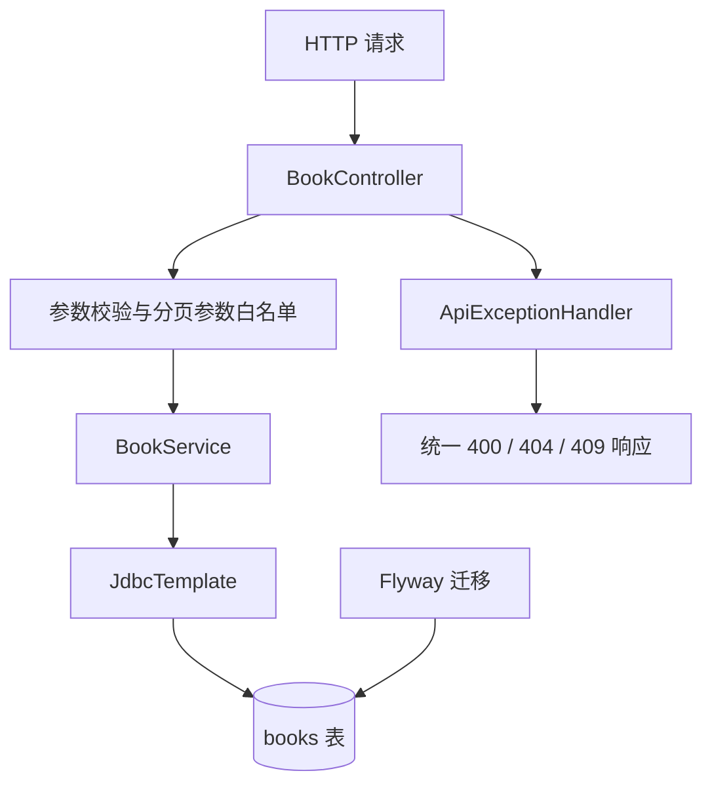

# Spring Boot 图书 REST API

独立的 Spring Boot 模块，练习 REST、参数校验、JDBC、事务、统一异常响应、分页搜索、价格过滤、ISBN 唯一约束、数据库迁移与 MockMvc 集成测试。不会改动现有的 JDBC 项目。

## 技术栈

- JDK 17 / Spring Boot 3.4.4
- Spring Web、Bean Validation、Spring JDBC
- H2（默认开发数据库）
- Flyway 数据库迁移（H2 / PostgreSQL）
- JUnit 5 + MockMvc
- Testcontainers PostgreSQL 集成测试（需要 Docker；无 Docker 时自动跳过）

## 启动与测试

在本目录执行：

```bash
mvn test
mvn package
mvn spring-boot:run
```

默认地址：`http://localhost:8080`。H2 使用内存数据库，应用重启后数据会重置。数据库结构由 `src/main/resources/db/migration` 下的 Flyway 脚本管理。

## API 清单

| 方法 | 路径 | 说明 | 成功状态 |
|---|---|---|---|
| GET | `/api/books` | 分页查询，可按书名/作者搜索并按价格筛选 | 200 |
| GET | `/api/books/{id}` | 查询单本图书 | 200 |
| POST | `/api/books` | 新增图书 | 201 |
| PUT | `/api/books/{id}` | 更新图书 | 200 |
| DELETE | `/api/books/{id}` | 删除图书 | 204 |
| POST | `/api/books/{bookId}/loans` | 借阅图书 | 201 |
| POST | `/api/loans/{loanId}/return` | 归还图书 | 200 |
| GET | `/api/books/{bookId}/stock` | 查询库存 | 200 |
| PATCH | `/api/books/{bookId}/stock` | 调整图书总库存 | 200 |
| GET | `/api/books/{bookId}/loans` | 查询借阅记录 | 200 |
| GET | `/api/books/{bookId}/stock-audit` | 查询库存审计流水 | 200 |

### 分页、搜索与价格筛选

`GET /api/books?q=java&page=0&size=20&sortBy=title&direction=asc&minPrice=10&maxPrice=100`

- `q`：可选，按书名或作者进行不区分大小写的包含匹配。
- `page`：从 0 开始，默认 0。
- `size`：每页数量，默认 20，允许 1–100，防止请求超大结果集。
- `sortBy`：只允许 `id`、`title`、`author`、`price`、`isbn`，默认 `id`。
- `direction`：只允许 `asc` 或 `desc`，默认 `asc`。
- `minPrice` / `maxPrice`：可选价格下限和上限，必须非负；同时传入时下限不能大于上限。
- 响应包含 `items`、`totalElements`、`page`、`size`、`totalPages`。当主排序字段相同时，以 `id ASC` 作为稳定的次级排序。

排序字段无法通过 SQL 参数占位符绑定，因此先用白名单校验，避免把用户输入直接拼接进 SQL。分页、关键字和价格值都通过参数化 SQL 传入。

### 新增/更新 JSON

```json
{
  "title": "Java 实战",
  "author": "张三",
  "price": 59.90,
  "isbn": "9787111111111"
}
```

ISBN 是可选字段。写入前会去掉连字符并转为大写；未填写时保存为 `NULL`。重复 ISBN 返回 HTTP 409。当前校验 ISBN 字符格式与长度，并不验证 ISBN 校验位。

### 统一错误码

错误响应基于 Problem Details，额外包含稳定的 `code` 字段：

| HTTP 状态 | code | 含义 |
|---|---|---|
| 400 | `VALIDATION_ERROR` | 请求体字段校验失败 |
| 400 | `INVALID_QUERY` | 查询参数缺失、格式非法，或分页、排序、价格范围不合法 |
| 400 | `INVALID_REQUEST_BODY` | JSON 无法解析或字段类型不匹配 |
| 404 | `BOOK_NOT_FOUND` | 图书不存在 |
| 404 | `LOAN_NOT_FOUND` | 借阅记录不存在 |
| 409 | `DUPLICATE_ISBN` | ISBN 已被其他图书使用 |
| 409 | `OUT_OF_STOCK` | 没有可借库存 |
| 409 | `LOAN_ALREADY_RETURNED` | 借阅记录已经归还 |
| 409 | `BOOK_HAS_LOAN_HISTORY` | 图书存在借阅历史，不能删除 |
| 409 | `STOCK_BELOW_BORROWED` | 新总库存小于当前借出数量 |

不要把 SQL、堆栈、密码或内部基础设施细节直接返回给客户端。

## PostgreSQL 集成测试

常规 `mvn test` 继续使用默认 H2 数据库。额外的 `PostgresLibraryApiIntegrationTest` 通过 Testcontainers 启动临时 PostgreSQL 16 容器，验证 Flyway 迁移、借阅、库存调整、审计查询，以及两个请求并发争抢最后一册时的库存保护。

- 运行 PostgreSQL 集成测试前需要安装并启动 Docker。
- Docker 不可用时，Testcontainers 会跳过该集成测试，H2 测试仍可照常执行。
- CI 若要强制执行 PostgreSQL 测试，应确保 runner 支持 Docker，并检查测试报告中该测试没有被跳过。

## 数据库配置

默认使用 H2。可以通过环境变量覆盖：

- `DB_URL`
- `DB_USERNAME`
- `DB_PASSWORD`
- `DB_DRIVER`
- `SERVER_PORT`

切换到 PostgreSQL/MySQL 时，还需要添加相应 JDBC 驱动，并审查 Flyway DDL、生成主键策略、分页 SQL 和大小写规则；不能只替换连接字符串就假设完全兼容。

## 架构



## 测试覆盖

- CRUD 生命周期、参数校验与 404。
- ISBN 规范化与唯一约束，重复 ISBN 返回 409。
- 价格区间过滤、非法区间和稳定业务错误码。
- 书名/作者关键字搜索、分页总数、页数与排序方向。
- 非法页码、非数字页码、超大 page size 和不在白名单中的排序字段。
- 格式错误的 JSON 与请求字段类型不匹配，统一返回 `INVALID_REQUEST_BODY`。
- 借阅、无库存冲突、归还、重复归还、库存查询和审计流水。
- 库存调整不能将总库存降至已借出数量以下；调整与审计在同一事务内完成，并通过库存审计接口显示 `ADJUST` 事件。
- H2 回归测试覆盖并发请求争抢最后一本图书；PostgreSQL Testcontainers 测试也验证同一并发约束。

## 数据库迁移原则

- `V1__create_books.sql` 创建图书表及搜索索引。
- `V2__add_isbn_to_books.sql` 增加 ISBN 字段和唯一索引。
- `V3__add_borrowing_and_stock_audit.sql` 增加库存字段、借阅记录表和借还库存审计表；已有图书默认总库存与可借库存均为 1。
- `V4__add_stock_adjustment_audit.sql` 为总库存调整建立独立审计表，避免改写已发布的 V3 迁移或放宽既有审计约束。
- 已应用的迁移脚本应视为不可变；后续结构变化应新增版本，不要改写已在环境执行过的迁移。
- H2 适合本地练习，但不能替代目标生产数据库上的集成测试。

## 库存调整

通过 `PATCH /api/books/{bookId}/stock` 调整总库存：

```json
{
  "totalCopies": 5
}
```

系统先锁定图书库存行，再计算已借出数量（`totalCopies - availableCopies`）。新总库存不能小于已借出数量，否则返回 `409 STOCK_BELOW_BORROWED`；成功后按已借出数量重新计算可借库存。库存变更与 V4 审计记录位于同一事务中。 `GET /api/books/{bookId}/stock-audit` 合并展示借出、归还和调整事件。无变化的调整请求不会产生冗余审计记录。

## 下一步

1. 扩展 PostgreSQL 集成测试到并发借阅、事务回滚和迁移升级场景；再评估 MySQL 兼容性。
2. 增加 OpenAPI、结构化日志、请求追踪 ID 与 Docker。
