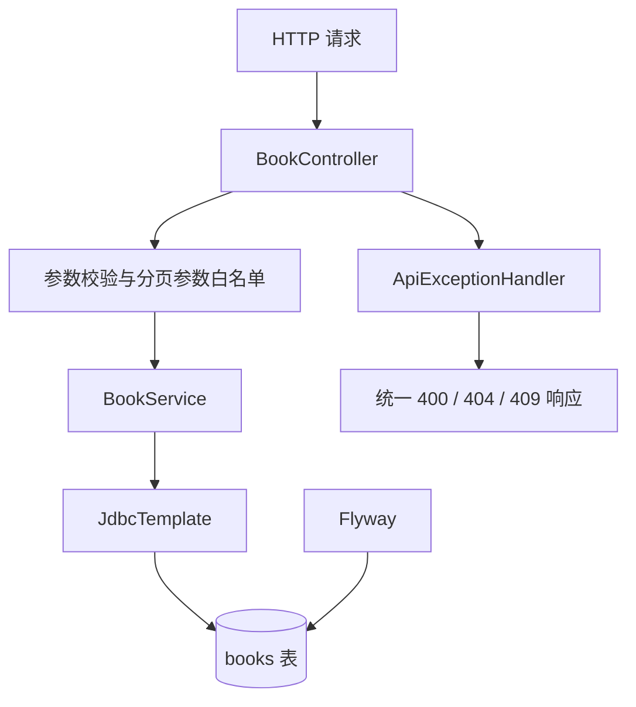

# Spring Boot 图书 REST API

独立的 Spring Boot 模块，练习 REST、参数校验、JDBC、事务、统一异常响应、分页搜索、数据库迁移与 MockMvc 集成测试。不会改动现有的 JDBC 项目。

## 技术栈

- JDK 17 / Spring Boot 3.4.4
- Spring Web、Bean Validation、Spring JDBC
- H2（默认开发数据库）
- Flyway 数据库迁移
- JUnit 5 + MockMvc

## 启动与测试

在本目录执行：

```bash
mvn test
mvn package
mvn spring-boot:run
```

默认地址：`http://localhost:8080`。H2 使用内存数据库，应用重启后数据会重置。数据库结构由 `src/main/resources/db/migration` 下的 Flyway 脚本管理。

## API 清单

| 方法 | 路径 | 说明 | 成功状态 |
|---|---|---|---|
| GET | `/api/books` | 分页查询，可按书名/作者搜索并按价格筛选 | 200 |
| GET | `/api/books/{id}` | 查询单本图书 | 200 |
| POST | `/api/books` | 新增图书 | 201 |
| PUT | `/api/books/{id}` | 更新图书 | 200 |
| DELETE | `/api/books/{id}` | 删除图书 | 204 |

### 分页与搜索

`GET /api/books?q=java&page=0&size=20&sortBy=title&direction=asc&minPrice=10&maxPrice=100`

- `q`：可选，按书名或作者进行不区分大小写的包含匹配。
- `page`：从 0 开始，默认 0。
- `size`：每页数量，默认 20，允许 1–100，防止请求超大结果集。
- `sortBy`：只允许 `id`、`title`、`author`、`price`，默认 `id`。
- `direction`：只允许 `asc` 或 `desc`，默认 `asc`。\n- `minPrice` / `maxPrice`：可选价格下限和上限，必须非负；同时传入时下限不能大于上限。\n- 排序支持 `id`、`title`、`author`、`price`、`isbn`；同值时以 `id ASC` 作为稳定的次级排序。
- 响应包含 `items`、`totalElements`、`page`、`size`、`totalPages`。

排序字段无法通过 SQL 参数占位符绑定，因此先用白名单校验，避免把用户输入直接拼接进 SQL。分页和过滤值仍通过参数化 SQL 传入。

### 新增/更新 JSON

```json
{
  "title": "Java 实战",
  "author": "张三",
  "price": 59.90
}
```

## 数据库配置

默认使用 H2。可以通过环境变量覆盖：

- `DB_URL`
- `DB_USERNAME`
- `DB_PASSWORD`
- `DB_DRIVER`
- `SERVER_PORT`

切换到 PostgreSQL/MySQL 时，还需要添加相应 JDBC 驱动，并审查 Flyway DDL、生成主键策略、分页 SQL 和大小写规则；不能只替换连接字符串就假设完全兼容。

## 架构



## 测试覆盖

- CRUD 生命周期、参数校验与 404。\n- ISBN 规范化与唯一约束，重复 ISBN 返回 409。\n- 价格区间过滤与稳定业务错误码（`VALIDATION_ERROR`、`INVALID_QUERY`、`BOOK_NOT_FOUND`、`DUPLICATE_ISBN`）。
- 书名/作者关键字搜索。
- 分页总数、页数、排序方向。
- 非法页码、超大 page size 和不在白名单中的排序字段。

## 下一步

1. 增加按价格区间过滤和 ISBN 唯一约束。
2. 加入 PostgreSQL/MySQL profile 与 Testcontainers 集成测试。
3. 加入借阅、库存锁定、归还与库存审计。
4. 增加 OpenAPI、结构化日志与 Docker。