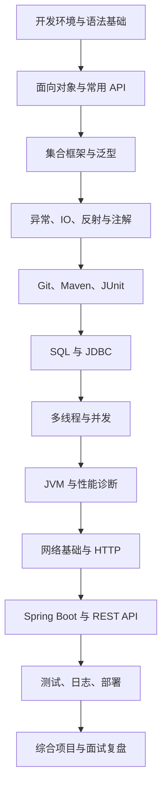

# Java 学习知识库

> 从 Java 基础到 JVM、并发、数据库与 Spring Boot 的系统化学习仓库。建议按路线逐步学习，每个专题都配合代码练习、复盘和面试自测。

## 快速开始

- [Java 学习路线](RoadMap/学习路线.md)
- [学习手册与专题导航](Doc/Java学习手册.md)
- [ArrayList 与集合源码阅读](Topics/14-ArrayList与集合源码.md)
- [线程池设计与任务治理](Topics/15-线程池设计与任务治理.md)
- [学习进度与项目清单](RoadMap/学习进度.md)
- [原有路线图（Excalidraw）](RoadMap/Java.excalidraw)

## 学习路径

## 专题目录

| 阶段 | 核心内容 | 学习目标 |
|---|---|---|
| 01 基础语法 | 变量、类型、运算符、流程控制、数组、方法 | 能独立编写小程序 |
| 02 面向对象 | 类、对象、封装、继承、多态、接口、抽象类 | 能进行基础建模 |
| 03 核心 API | String、包装类、日期时间、Object、枚举 | 熟悉常见标准库 |
| 04 集合与泛型 | List、Set、Map、Queue、迭代器、泛型 | 能选择合适的数据结构 |
| 05 异常与工程化 | 异常、日志、JUnit、Maven、Git | 写出可维护的项目 |
| 06 进阶语言特性 | Lambda、Stream、Optional、反射、注解 | 理解现代 Java 写法 |
| 07 IO 与网络 | 文件、NIO、序列化、Socket、HTTP | 能处理文件与基础通信 |
| 08 数据持久化 | SQL、JDBC、事务、连接池 | 能完成数据库读写 |
| 09 并发编程 | 线程、锁、线程池、并发容器、CompletableFuture | 理解并发安全与任务编排 |
| 10 JVM | 内存区域、类加载、GC、诊断工具 | 能解释常见运行时问题 |
| 11 后端开发 | Spring Boot、REST、校验、配置、测试 | 能构建后端服务 |
| 12 项目与面试 | 综合项目、代码审查、常见面试题 | 形成完整作品与表达能力 |

## 每个专题的学习方法

1. **先理解问题**：说明概念解决什么问题，以及不用它会怎样。
2. **再阅读代码**：示例尽量可独立运行，注明 JDK 版本与运行命令。
3. **动手修改**：至少完成一个基础练习和一个边界条件练习。
4. **画出关系**：复杂机制使用 Mermaid 表达调用链、生命周期或数据流。
5. **复述与复盘**：回答“是什么、为什么、怎么用、代价是什么、常见错误是什么”。

## 建议环境

- JDK：优先使用仍受支持的 LTS 版本；学习时明确记录实际使用的 JDK 版本。
- IDE：IntelliJ IDEA 或其他支持 Java 的 IDE。
- 构建：先掌握命令行编译运行，再学习 Maven。
- 测试：JUnit；项目练习中加入边界条件与异常路径测试。
- 版本管理：Git，保持每个练习可追踪。

## 项目练习阶梯

1. 控制台通讯录：类设计、集合、输入校验。
2. 文件记账本：日期时间、IO、异常处理、单元测试。
3. JDBC 图书管理：SQL、事务、DAO 分层。
4. 并发任务处理器：线程池、超时、取消、异常收集。
5. Spring Boot 待办 API：REST、校验、持久化、测试、日志。
6. 综合项目：补充 README、架构图、启动说明、测试方法与已知限制。

## 可运行练习

- [Java Core Lab：集合算法与 JUnit 5 测试](Practice/java-core-lab/README.md)
- 使用 JDK 17 + Maven，执行 `cd Practice/java-core-lab && mvn test`。
- GitHub Actions 已配置自动测试工作流；工作流运行结果需以仓库 Actions 页面为准。

## 原有资料

- `JavaFly/`：保留原有项目与相关配置。
- `JetBrains/`：保留原有 IDE 相关资料。
- `MindManager/`：保留原有思维导图资料。
- `Doc/Image/`：保留已有图片素材。

> 本仓库是持续迭代的学习笔记。遇到版本相关的 API 或框架行为时，应以对应版本的官方文档为准。
