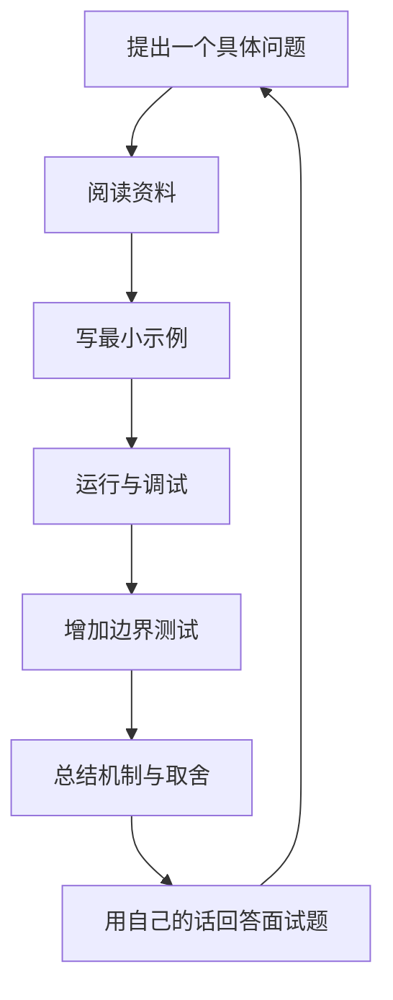

# Java 学习路线

## 总体目标

从“能看懂语法”逐步走到“能独立设计、实现、测试和解释一个 Java 项目”。不要只背 API；每一阶段都要产出代码和复盘记录。

## 阶段路线

| 阶段 | 学习内容 | 必做产出 | 自测标准 |
|---|---|---|---|
| 1. 基础语法 | 类型、运算符、条件、循环、数组、方法 | 计算器、猜数字、数组统计 | 能独立编写并调试 |
| 2. 面向对象 | 类、构造器、封装、继承、多态、接口 | 通讯录领域模型 | 能解释接口与继承的取舍 |
| 3. 核心 API | String、Object、包装类、日期时间、枚举 | 文本分析器 | 能处理空值与边界情况 |
| 4. 集合与泛型 | List/Set/Map、迭代器、比较器、泛型 | 高频词统计器 | 能解释集合选择与复杂度 |
| 5. 工程化 | Maven、Git、JUnit、日志、包结构 | 有测试的多模块小项目 | 能从命令行构建与测试 |
| 6. IO 与数据库 | 文件、NIO、SQL、JDBC、事务 | 文件记账本或图书管理 | 能处理资源关闭和事务失败 |
| 7. 并发与 JVM | 线程、锁、线程池、内存、GC | 并发任务处理器 | 能识别竞态、死锁和资源泄漏风险 |
| 8. Web 后端 | HTTP、REST、Spring Boot、校验、持久化 | 待办事项 API | 能运行、测试并说明接口 |
| 9. 综合项目 | 需求拆解、架构、测试、部署、文档 | 一个可演示的完整项目 | 新环境可按 README 复现 |

## 每周学习节奏（可调整）

- 40%：阅读概念并整理自己的解释。
- 40%：编写、运行、调试代码。
- 20%：复习旧题、补测试、写面试回答。

## 学习闭环

## 进入下一阶段前的检查

- [ ] 能不照抄地讲清核心概念。
- [ ] 能独立写出最小可运行示例。
- [ ] 至少测试一个正常路径和两个边界/异常路径。
- [ ] 能说明复杂度、资源成本或设计取舍（适用时）。
- [ ] 能把关键知识整理成一张复习卡片。
