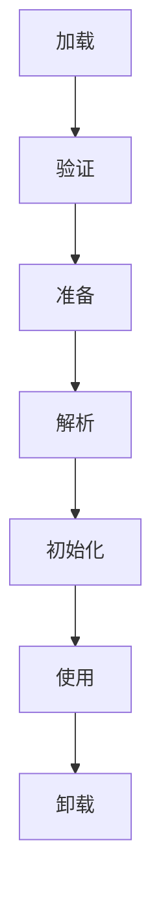

# JVM 与内存基础

## 先区分几个概念

- **JVM**：执行 Java 字节码的虚拟机规范及其实现。
- **堆**：通常存放对象实例，是垃圾回收重点管理的区域。
- **线程私有区域**：每个线程有自己的程序计数器、Java 虚拟机栈等运行时数据。
- **类元数据**：HotSpot 等实现通常使用 Metaspace 存放类元数据；这不是 Java 堆的一部分。
- **本地内存**：虚拟机和本地代码使用的内存，不能简单等同于 Java 堆。

具体实现和版本会影响细节，回答问题时应注明讨论的是规范层面还是某个 JVM 实现。

## 类加载的概念流程

这是帮助理解的概念流程；实际执行中部分步骤可能交错或延迟发生，不应把图理解成每次都严格线性、同步完成。

## 垃圾回收基础

垃圾回收器判断对象是否仍可达，并根据实现采用不同算法与分代/区域策略。不要把“调用 System.gc()”理解为强制立即回收，也不要仅凭一次内存快照就断言内存泄漏。

## 常用诊断思路

1. 先记录现象：延迟、吞吐、内存占用、错误信息。
2. 收集证据：日志、线程转储、堆转储、GC 日志、监控指标。
3. 建立假设并验证，不凭单一症状下结论。
4. 修改后进行对比测试，确认问题是否改善且没有引入回归。

常见工具包括 `jcmd`、`jstack`、`jmap`、`jstat` 以及 JDK Mission Control / Java Flight Recorder。工具选项可能随 JDK 版本变化，先查看当前版本的帮助信息。

## 常见问题

- `OutOfMemoryError` 不只意味着 Java 堆不足。
- `StackOverflowError` 常与过深递归等栈使用问题相关。
- 内存持续增长可能来自缓存、集合引用、线程或本地资源，不一定都是 GC 算法问题。
- 频繁 Full GC 是需要调查的信号，不是单独的根因结论。

## 练习与面试自测

- 画出运行时数据区并标注线程共享/私有。
- 解释类加载、初始化与类初始化时机。
- 如何区分内存泄漏与正常缓存增长？
- 发生高 CPU 时，你会先收集哪些证据？
