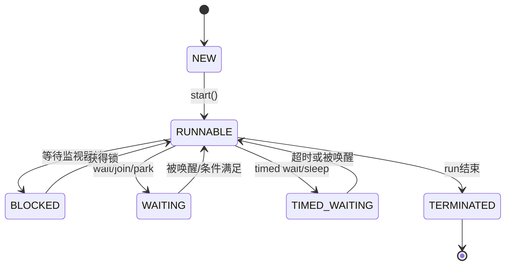

# Java 并发编程

## 目标

理解线程与任务的区别，识别共享状态风险，能够用线程池组织任务并处理超时、取消和异常。

## 线程安全的核心问题

多个线程同时访问共享可变状态时，可能出现竞态条件、可见性问题和指令重排序带来的意外行为。优先考虑不可变对象、局部变量、消息传递和缩小共享状态范围。

## 线程池示例

```java
import java.util.concurrent.*;

public class ExecutorExample {
    public static void main(String[] args) throws Exception {
        ExecutorService pool = Executors.newFixedThreadPool(2);
        try {
            Future<Integer> result = pool.submit(() -> 20 + 22);
            System.out.println(result.get(2, TimeUnit.SECONDS));
        } finally {
            pool.shutdown();
            if (!pool.awaitTermination(3, TimeUnit.SECONDS)) {
                pool.shutdownNow();
            }
        }
    }
}
```

生产代码还需考虑线程命名、队列容量、拒绝策略、任务异常、超时策略和关闭过程。不要无条件使用无界队列或无限制创建线程。

## 关键概念

- `synchronized`：互斥与内存可见性语义。
- `volatile`：保证特定读写的可见性和有序性，不保证复合操作原子性。
- `Lock`：提供显式锁操作与更灵活的能力，必须妥善释放。
- 原子类：适合特定变量的原子更新。
- 并发容器：提供相应的并发访问语义，但不自动保证多步业务操作整体原子。
- `CompletableFuture`：组合异步计算，需明确使用的执行器与异常处理策略。

## 线程状态示意



该图用于学习常见状态；真实线程状态转换由具体阻塞原因和 JVM 行为决定。

## 练习

1. 用多个线程对共享计数器累加，观察竞态并修复。
2. 给线程池设置合理队列和拒绝策略。
3. 为异步任务增加超时、取消和异常处理。
4. 用线程转储分析一个人为制造的死锁。

## 面试自测

- volatile 为什么不能替代所有 synchronized？
- 什么是死锁？如何预防和排查？
- 线程池有哪些关键参数？
- Future.get 的超时意味着任务一定停止了吗？
