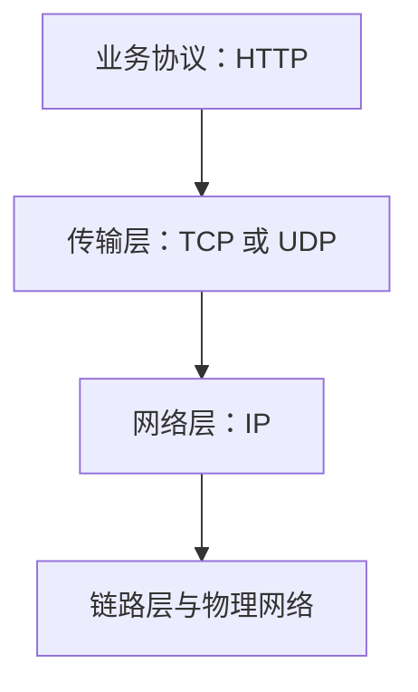

# IO、NIO 与网络基础

## IO 选择思路

- 字节流适合原始二进制数据；字符流适合文本。
- 明确文本编码，避免依赖平台默认字符集。
- 对文件、流、Socket 等资源优先使用 try-with-resources。
- 大文件处理应关注缓冲、内存占用和异常恢复。

## 使用明确的 UTF-8 读取文本

```java
import java.io.IOException;
import java.nio.charset.StandardCharsets;
import java.nio.file.Files;
import java.nio.file.Path;
import java.util.List;

public class TextFileExample {
    static List<String> readLines(Path path) throws IOException {
        return Files.readAllLines(path, StandardCharsets.UTF_8);
    }
}
```

`readAllLines` 会把所有行载入内存；对于超大文件，应考虑逐行流式处理并关闭返回的 Stream。

## 网络分层直觉



HTTP 是应用层协议；TCP 提供可靠、有序的字节流，不保留应用消息边界。应用协议需要自行定义消息边界或使用已有协议格式。

## 常见错误

- 假定一次 read 就能读满预期字节数。
- 假定 TCP 一次 write 对应对端一次 read。
- 忽略字符编码、换行和文件权限。
- 网络调用没有连接/读取超时。
- 异常时未关闭资源，或无限重试导致雪崩。

## 练习与面试自测

- 将一个大文本文件逐行统计，不一次性加载全部内容。
- 解释字节流与字符流的区别。
- 为什么 TCP 是字节流而不是消息协议？
- 设计网络客户端时应考虑哪些超时与重试策略？
