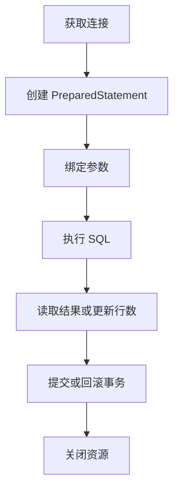

# SQL 与 JDBC

## JDBC 基本流程



## 参数化查询

```java
String sql = "SELECT id, name FROM users WHERE id = ?";
try (var connection = dataSource.getConnection();
     var statement = connection.prepareStatement(sql)) {
    statement.setLong(1, userId);
    try (var result = statement.executeQuery()) {
        while (result.next()) {
            long id = result.getLong("id");
            String name = result.getString("name");
            System.out.println(id + ": " + name);
        }
    }
}
```

使用 PreparedStatement 绑定数据参数，可降低 SQL 注入风险。表名、列名等 SQL 结构通常不能直接作为普通参数绑定；动态结构应通过白名单选择。

## 事务要点

事务通常围绕一组需要共同成功或失败的数据库操作。手动事务需要明确提交与回滚，并确保异常路径也被处理。连接池负责复用连接，但不意味着可以忽略连接状态的正确归还。

## 基本 SQL 能力清单

- SELECT、WHERE、ORDER BY、LIMIT / 分页
- INSERT、UPDATE、DELETE
- JOIN、GROUP BY、HAVING、聚合函数
- 主键、唯一约束、外键、索引
- 事务、隔离级别、锁与并发更新
- 执行计划与索引选择

## 练习

实现一个图书管理 DAO，包含查询、新增、更新和删除。至少测试重复数据、找不到记录、事务失败和特殊字符输入。

## 面试自测

- Statement 与 PreparedStatement 的区别是什么？
- 索引为什么能加速查询，又有什么成本？
- 事务的 ACID 分别是什么？
- 为什么数据库连接和 ResultSet 必须正确关闭？
