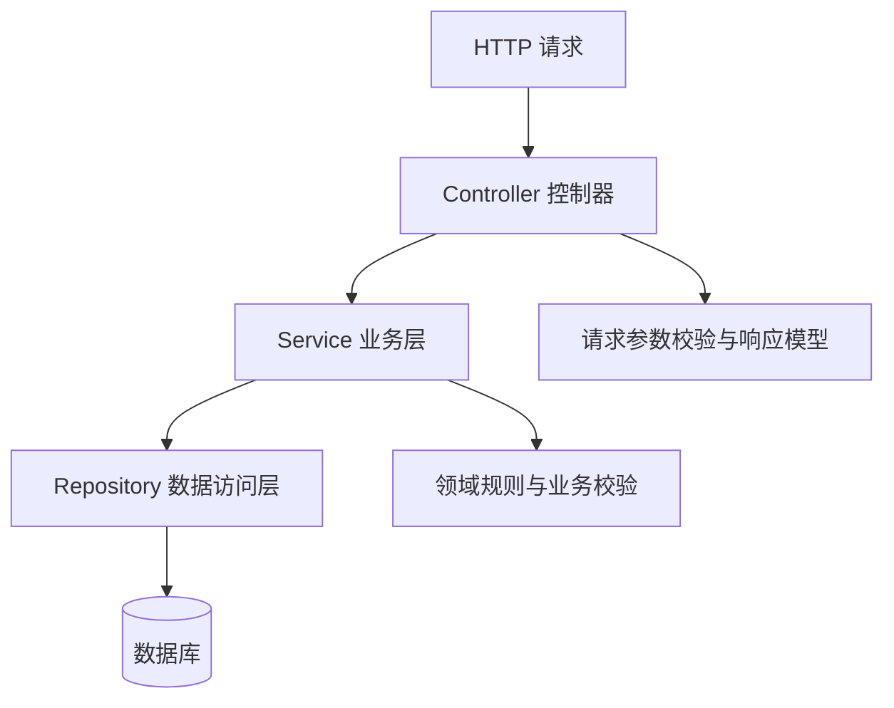

# Spring Boot 入门路线

## 学习目标

能构建一个小型 REST API，理解控制器、业务服务、数据访问、配置、参数校验和测试的职责边界。

## 建议分层

分层是帮助管理依赖与职责的手段，不是要求每个简单功能都创建大量空类。应根据项目复杂度保持适度。

## 推荐学习顺序

1. 创建 Spring Boot 项目，理解启动类与自动配置。
2. 使用 Controller 返回简单 JSON。
3. 使用 DTO 表达请求与响应，避免直接暴露内部实体。
4. 添加 Bean Validation 参数校验与统一异常处理。
5. 接入数据库和事务，理解 Repository / DAO 的边界。
6. 编写 Web 层与业务层测试。
7. 配置日志、健康检查、环境配置和安全策略。
8. 使用容器或部署脚本复现运行环境。

## 设计注意点

- 不要把所有业务逻辑写在 Controller。
- 不要把密码、令牌、数据库口令提交到 Git。
- 对外接口需要明确错误码、状态码和输入约束。
- 数据库写操作应明确事务边界。
- 测试应隔离外部服务，并覆盖失败路径。
- 版本选择以项目需求和官方兼容性说明为准。

## 项目练习：待办事项 API

建议接口：
- `GET /api/todos`：分页查询。
- `GET /api/todos/{id}`：查询单条。
- `POST /api/todos`：创建。
- `PATCH /api/todos/{id}`：更新部分字段。
- `DELETE /api/todos/{id}`：删除。

交付要求：README 含 JDK 版本、配置说明、启动命令、测试命令、接口示例和已知限制；提供数据库迁移或初始化方式，不提交真实凭据。

## 面试自测

- Spring IoC 与依赖注入解决什么问题？
- Controller、Service、Repository 的职责是什么？
- 什么是自动配置？
- 如何设计统一异常处理？
- 如何测试依赖数据库的业务逻辑？
