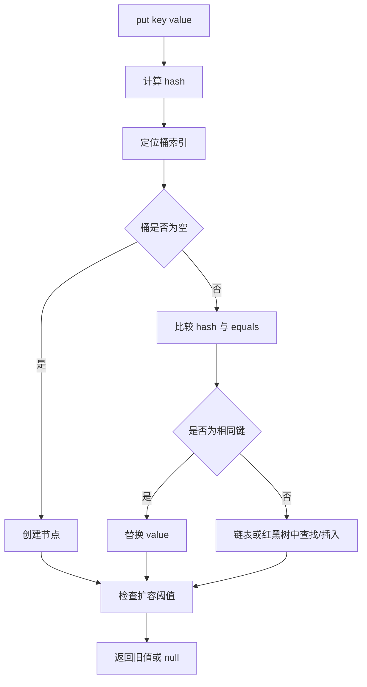

# HashMap 底层原理与源码分析

> 适用基线：JDK 8+。以下描述以常见 OpenJDK 实现为学习对象；具体实现细节可能随 JDK 版本变化，不能把实现细节误认为 Java API 的永久保证。

## 1. HashMap 解决什么问题？

HashMap 通过键的哈希值定位桶，再通过相等性判断定位具体键值对。理想情况下，查询、插入和删除的平均时间复杂度接近 O(1)，但性能依赖哈希分布、容量、键的实现以及冲突情况。

## 2. 数据结构概览



常见 OpenJDK 8+ 实现中，桶内冲突结构可以是链表；达到实现规定的条件后，链表可能树化为红黑树。树化并非只由单一链表长度决定，还会受到表容量等条件影响。

## 3. 哈希与桶索引

常见实现会对键的 `hashCode()` 做扰动，再使用数组容量相关的位运算定位桶。容量通常保持为 2 的幂，便于使用位掩码计算索引。

```java
int index = (table.length - 1) & hash;
```

当哈希值分布较差时，不同键会落到同一个桶，这称为哈希冲突。冲突并不意味着键相同，仍需根据 hash 与 equals 等规则判断。

## 4. put 与 get 的关键路径

- `put`：处理空桶、替换已有键、链表/树中插入新节点，并在需要时扩容。
- `get`：先定位桶，再检查首节点，随后在桶内结构中查找。
- `remove`：定位节点并从桶结构中移除。
- `resize`：扩展桶数组，并重新安排节点位置；扩容会产生额外时间和内存成本。

## 5. equals 与 hashCode 契约

1. 如果 `a.equals(b)` 为 `true`，那么 `a.hashCode() == b.hashCode()` 必须成立。
2. hashCode 相同不代表 equals 为 true。
3. 作为键使用期间，参与 `equals` / `hashCode` 的字段应保持稳定。
4. `equals` 的定义应满足自反、对称、传递、一致性，并对非 null 对象返回 false。

对象入 Map 后若修改参与 hashCode 的字段，之后可能无法通过新哈希定位到原来的桶，从而出现“明明放进去却取不到”的现象。

## 6. 扩容与负载因子

容量表示桶数组长度；负载因子用于计算触发扩容的阈值。默认值、具体扩容规则和树化阈值属于实现层面的知识，应结合所用 JDK 的源码版本验证。

- 容量偏小：冲突可能增多。
- 容量偏大：占用更多内存，也可能浪费空间。
- 预估元素数量：可减少反复扩容，但不要机械地为每个 Map 分配巨大容量。

## 7. 线程安全

HashMap 不是并发写入容器。多个线程并发修改共享 HashMap，可能产生数据竞争和不可靠结果。选择方案时应依据业务语义：无共享或线程封闭时普通 HashMap 通常足够；多线程并发访问可评估 ConcurrentHashMap；多步复合操作还要检查整体原子性需求。

## 8. 常见误区

- 把平均 O(1) 理解成任何情况下都 O(1)。
- 认为 hashCode 相同就表示键相等。
- 重写 equals，却忘记重写 hashCode。
- 将可变对象作为键并在插入后修改关键字段。
- 把 HashMap 当作线程安全容器。
- 将某个 OpenJDK 版本的内部阈值当成 Java 规范承诺。

## 9. 练习

1. 编写 EmployeeKey，只以工号作为相等性字段，验证 HashMap 覆盖行为。
2. 构造 hashCode 恒定的键，观察冲突时 equals 如何参与判断。
3. 设计可变键反例，解释修改字段后为什么可能无法 get。
4. 使用 JMH（独立基准测试项目）比较不同键分布；不要用一次简单循环得出性能结论。

## 10. 面试自测

- HashMap 如何处理哈希冲突？
- 为什么 equals 相等时 hashCode 必须相等？
- 扩容解决什么问题？成本是什么？
- 为什么可变对象不适合直接作为 Map 的键？
- HashMap 与 ConcurrentHashMap 的适用场景有什么不同？

## 官方资料

- [Map API](https://docs.oracle.com/en/java/javase/17/docs/api/java.base/java/util/Map.html)
- [HashMap API](https://docs.oracle.com/en/java/javase/17/docs/api/java.base/java/util/HashMap.html)
- [OpenJDK 源码](https://github.com/openjdk/jdk)