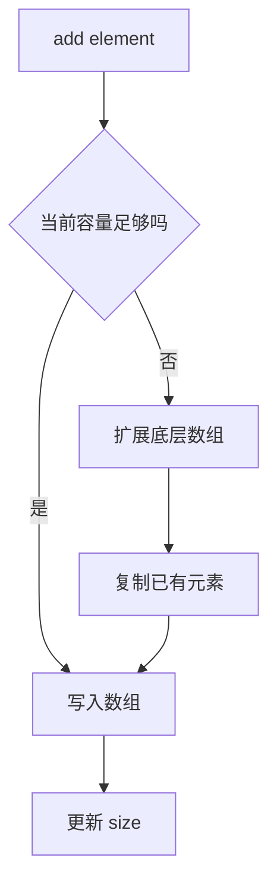

# ArrayList 与集合源码阅读

> 基于 Java 17 公共 API，内部实现以常见 OpenJDK 实现为参考。源码细节可能随版本变化。

## 1. ArrayList 的核心结构

`ArrayList` 是基于数组的 `List` 实现，适合频繁按下标访问。尾部追加通常成本较低；中间插入或删除通常需要移动后续元素。



## 2. 常见复杂度与使用场景

| 操作 | ArrayList 常见成本 | 说明 |
|---|---|---|
| `get(index)` | O(1) | 直接按下标访问数组 |
| 尾部 `add` | 摊销 O(1) | 扩容时会发生复制 |
| 中间插入 | O(n) | 后续元素需要移动 |
| 按值查找 | O(n) | 需要逐个比较 |
| 删除中间元素 | O(n) | 后续元素需要移动 |

这些是典型复杂度分析，不代表每次操作都耗时相同。实际性能还受数据规模、对象分配、缓存局部性和 JVM 优化影响。

## 3. 容量与 size 不同

- `size`：当前存储的元素数量。
- `capacity`：底层数组可容纳元素的数量，是实现细节，公共 API 不提供直接读取方法。
- `ensureCapacity`：已知即将加入大量元素时，可考虑提前预留容量，减少反复扩容。

不要依赖特定 JDK 版本的精确扩容倍数编写业务逻辑。

## 4. fail-fast 不是并发安全保证

遍历过程中，如果集合发生了结构性修改，迭代器可能抛出 `ConcurrentModificationException`。这是尽早发现部分错误用法的 fail-fast 行为，不是线程同步机制，也不保证检测到所有并发修改。

```java
List<String> names = new ArrayList<>(List.of("Ada", "Linus", "Grace"));
for (String name : names) {
    if (name.startsWith("L")) {
        // names.remove(name); // 不要在增强 for 中这样修改原集合
    }
}
```

如果需要按条件删除，可以使用 `removeIf`；若确实需要迭代中修改，研究 `Iterator.remove()` 的约束。

## 5. List、Set、Queue 如何选

- `ArrayList`：需要顺序、索引访问，遍历频繁。
- `HashSet`：需要按相等性去重，不依赖遍历顺序。
- `LinkedHashSet`：需要去重且保留插入顺序。
- `TreeSet`：需要按自然顺序或 Comparator 排序。
- `ArrayDeque`：常见栈/队列操作；通常比旧式 `Stack` 更适合新代码。
- `PriorityQueue`：需要优先级队列，而不是完整排序后的列表。

## 6. 练习

1. 比较对 `ArrayList` 和 `LinkedList` 做 100,000 次随机下标读取的差异，并解释原因。正式性能结论应使用 JMH，而不是一次手工计时。
2. 将遍历中删除元素的代码分别改为 `removeIf` 与 `Iterator.remove()`。
3. 分别使用 `HashSet`、`LinkedHashSet`、`TreeSet` 去重，观察顺序差异。
4. 为一个容量预估合理的列表写基准测试，比较默认构造与预留容量。

## 7. 面试自测

- 为什么 ArrayList 的尾部追加是摊销 O(1)？
- size 与 capacity 有什么区别？
- fail-fast 为什么不能替代同步？
- ArrayList 与 LinkedList 的选择应该看哪些操作模式？
- ArrayDeque、PriorityQueue 分别适合什么问题？

## 官方资料

- [List API](https://docs.oracle.com/en/java/javase/17/docs/api/java.base/java/util/List.html)
- [ArrayList API](https://docs.oracle.com/en/java/javase/17/docs/api/java.base/java/util/ArrayList.html)
- [ArrayDeque API](https://docs.oracle.com/en/java/javase/17/docs/api/java.base/java/util/ArrayDeque.html)