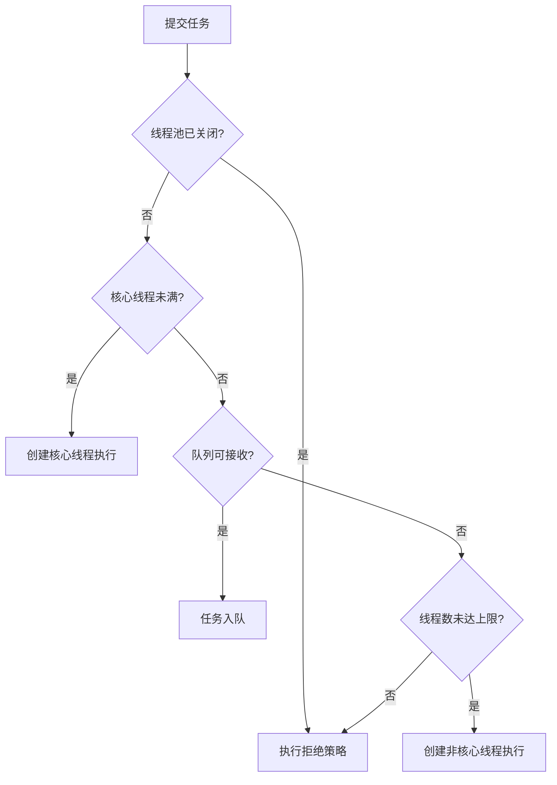

# 线程池设计与任务治理

## 1. 为什么需要线程池？

线程池复用工作线程，并把任务提交、排队、执行和关闭纳入统一管理。它不是“线程越多越快”的开关；线程数、队列长度和拒绝策略都应该与任务特征、资源上限和延迟目标匹配。

## 2. ThreadPoolExecutor 的关键参数

| 参数 | 作用 | 设计时要问的问题 |
|---|---|---|
| `corePoolSize` | 核心线程数 | 常驻并发能力需要多大？ |
| `maximumPoolSize` | 最大线程数 | 突发时允许多少线程？ |
| `keepAliveTime` | 非核心线程空闲存活时间 | 空闲资源何时回收？ |
| `workQueue` | 任务等待队列 | 能接受多大的排队延迟与内存占用？ |
| `threadFactory` | 创建工作线程 | 是否需要命名、设置异常处理？ |
| `RejectedExecutionHandler` | 任务无法接收时的策略 | 调用方如何感知过载？ |

重要：当使用无界队列时，线程池通常不会仅因队列不断增长而扩展到 `maximumPoolSize`；无界排队也可能导致内存压力和高延迟。

## 3. 任务生命周期



## 4. 显式配置线程池

```java
import java.util.concurrent.ArrayBlockingQueue;
import java.util.concurrent.ThreadPoolExecutor;
import java.util.concurrent.TimeUnit;

ThreadPoolExecutor executor = new ThreadPoolExecutor(
        2,
        4,
        30,
        TimeUnit.SECONDS,
        new ArrayBlockingQueue<>(100),
        Thread.ofPlatform().name("order-worker-", 0).factory(),
        new ThreadPoolExecutor.AbortPolicy());
```

上例使用 `Thread.ofPlatform()`，要求较新的 JDK（JDK 19 引入）；若以 JDK 17 为项目基线，应换成自定义 `ThreadFactory` 或默认工厂并自行设置线程名。线程池配置需要按 CPU 密集型、I/O 密集型、任务时延和下游容量压测，不应机械套用固定公式。

## 5. Future、超时与取消

- `Future.get(timeout, unit)` 超时只表示等待方停止等待结果，不代表任务一定已停止。
- `cancel(true)` 会尝试中断执行线程；任务必须配合中断机制才可能及时退出。
- 任务代码应在合适的循环或阻塞点检查中断状态，并正确处理 `InterruptedException`。
- 关闭时先 `shutdown()`，在限定时间内等待；超时后再考虑 `shutdownNow()`，并记录未完成任务。

## 6. 常见误区

- 使用无界队列却认为 `maximumPoolSize` 一定能应对积压。
- 使用 `CallerRunsPolicy` 却没评估提交线程是否可以承担执行任务。
- 忽略拒绝策略导致请求静默丢失。
- 把 `Future` 超时当成底层任务已取消。
- 只调线程数，不监控队列长度、拒绝数、执行耗时和任务失败率。

## 7. 练习

1. 用有界队列模拟过载，记录任务提交量、完成量和拒绝数。
2. 编写一个响应中断的长任务，验证 `cancel(true)` 的实际效果。
3. 对比 `AbortPolicy` 和 `CallerRunsPolicy`，分析两者对调用方延迟的影响。
4. 设计线程池监控指标：活跃线程数、队列长度、完成任务数、拒绝次数、任务执行耗时。

## 8. 面试自测

- ThreadPoolExecutor 的任务接收顺序是什么？
- 为什么不建议无脑使用无界队列？
- Future 超时和任务取消有什么区别？
- 线程池拒绝策略如何影响系统背压？
- CPU 密集型和 I/O 密集型任务的线程池设计有哪些差异？

## 官方资料

- [ThreadPoolExecutor API](https://docs.oracle.com/en/java/javase/17/docs/api/java.base/java/util/concurrent/ThreadPoolExecutor.html)
- [ExecutorService API](https://docs.oracle.com/en/java/javase/17/docs/api/java.base/java/util/concurrent/ExecutorService.html)