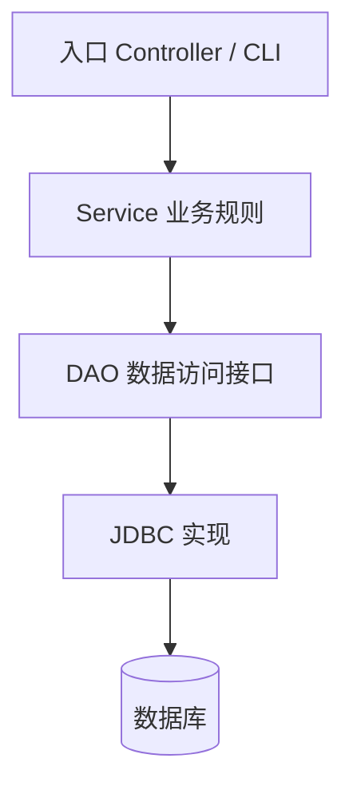

# JDBC 事务与 DAO 分层实战

## 1. 分层解决什么问题？

DAO（Data Access Object）负责把 SQL 与结果映射封装起来；Service 负责业务规则与事务边界；Controller 或命令行入口负责接收输入、组织输出。分层的价值是让业务逻辑不必散落在 SQL 字符串中，也让 DAO 能够独立测试。



## 2. JDBC 查询的标准流程

1. 从连接池或连接管理组件取得 `Connection`。
2. 创建 `PreparedStatement` 并绑定参数。
3. 执行查询或更新。
4. 将 `ResultSet` 映射为领域对象。
5. 通过 try-with-resources 关闭 `ResultSet`、`Statement`；连接的归还方式取决于连接所有权。

```java
String sql = "SELECT id, title FROM books WHERE author = ?";
try (PreparedStatement ps = connection.prepareStatement(sql)) {
    ps.setString(1, author);
    try (ResultSet rs = ps.executeQuery()) {
        while (rs.next()) {
            long id = rs.getLong("id");
            String title = rs.getString("title");
            // 映射为领域对象或交给结果集合
        }
    }
}
```

不要把用户输入直接拼进 SQL。参数占位符适用于值，不适用于表名、列名或 `ORDER BY` 关键字；动态标识符需要白名单映射。

## 3. 事务的 ACID 视角

- **原子性**：一组操作要么全部成功，要么全部回滚。
- **一致性**：业务规则和数据库约束在事务前后成立。
- **隔离性**：并发事务之间按所选隔离级别限制相互影响。
- **持久性**：提交成功后，数据库按其持久化保证保存结果。

## 4. JDBC 事务基本模板

```java
boolean originalAutoCommit = connection.getAutoCommit();
try {
    connection.setAutoCommit(false);
    // 执行属于同一业务操作的多条 SQL
    connection.commit();
} catch (SQLException | RuntimeException ex) {
    try {
        connection.rollback();
    } catch (SQLException rollbackError) {
        ex.addSuppressed(rollbackError);
    }
    throw ex;
} finally {
    try {
        connection.setAutoCommit(originalAutoCommit);
    } catch (SQLException restoreError) {
        // 真实项目应交由统一异常/连接管理策略处理，不能静默忽略
    }
}
```

这段代码展示了基本结构；生产实现需要定义恢复 `autoCommit` 失败时的处理方式，并确保连接由同一层负责归还或关闭。连接池环境下，事务完成后必须把连接恢复到可复用状态。

## 5. 常见故障与排查

| 症状 | 常见原因 | 排查方向 |
|---|---|---|
| SQL 注入风险 | 拼接用户输入 | 改为 PreparedStatement 参数绑定 |
| 连接泄漏 | 未关闭资源或连接归还不完整 | try-with-resources、连接池泄漏检测 |
| 部分写入 | 多条 SQL 没有统一事务 | 在 Service 层界定事务 |
| 更新 0 行 | ID 不存在或条件不匹配 | 检查 WHERE 条件与返回行数 |
| 金额精度问题 | 使用 `double` 存储金额 | 使用 `BigDecimal` 与 DECIMAL/NUMERIC |
| 并发覆盖 | 读后写无并发控制 | 乐观锁、版本列、约束或适当锁策略 |

## 6. 实战仓库

配套项目：[JDBC 图书管理练习](../Practice/jdbc-library/README.md)。项目实现 Book、DAO 接口、JDBC DAO、CRUD 与 JUnit 测试；H2 仅用于练习，真实部署需替换为目标数据库驱动与连接管理方案。

## 7. 练习与面试自测

1. 为借书操作实现 Service：校验库存、创建借阅记录、扣减库存，并保证事务原子性。
2. 人为在第二条 SQL 后抛出异常，验证回滚后数据库没有部分变更。
3. 解释 `executeQuery`、`executeUpdate` 的适用场景。
4. 为什么 PreparedStatement 不能直接绑定表名？
5. JDBC Connection、Statement、ResultSet 分别由谁创建和关闭？
6. 事务隔离级别会影响哪些并发异常？

## 官方资料

- [JDBC Basics](https://docs.oracle.com/javase/tutorial/jdbc/basics/)
- [Connection API](https://docs.oracle.com/en/java/javase/17/docs/api/java.sql/java/sql/Connection.html)
- [PreparedStatement API](https://docs.oracle.com/en/java/javase/17/docs/api/java.sql/java/sql/PreparedStatement.html)