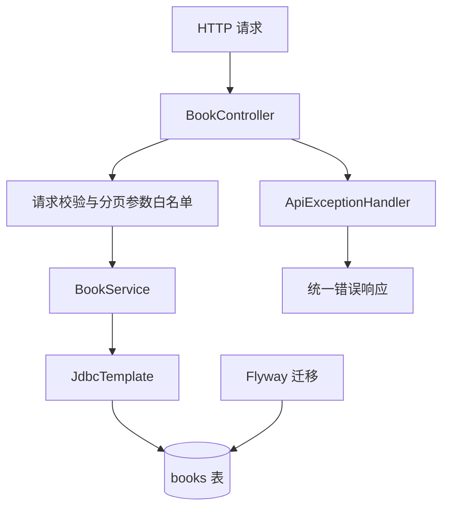

# 17｜Spring Boot REST API 实战

> 配套项目：[Spring Boot 图书 REST API](../Practice/springboot-library-api/README.md)  
> 基线：JDK 17、Spring Boot 3.4.4、Spring Web、Bean Validation、Spring JDBC、Flyway、H2、JUnit 5。

## 1. 从 HTTP 请求到数据库

REST API 将资源通过统一的 HTTP 方法暴露给调用方。Controller 负责协议适配，Service 负责业务规则，数据访问层通过 JdbcTemplate 执行 SQL。



## 2. REST 方法与状态码

| 操作 | HTTP 方法 | 路径 | 成功状态 |
|---|---|---|---|
| 分页查询/搜索 | GET | /api/books | 200 OK |
| 查询单本 | GET | /api/books/{id} | 200 OK |
| 新增 | POST | /api/books | 201 Created |
| 更新 | PUT | /api/books/{id} | 200 OK |
| 删除 | DELETE | /api/books/{id} | 204 No Content |

GET 不应产生业务副作用；POST 创建资源；PUT 表示整体更新。资源不存在返回 404，输入校验失败返回 400。HTTP 状态码是 API 契约的一部分，不应把所有失败都包装成 200。

## 3. DTO 与输入校验

请求 DTO 与数据库模型分开，避免客户端直接决定数据库字段。项目的 `BookRequest` 使用 `@NotBlank`、`@Size`、`@NotNull` 和 `@DecimalMin` 校验书名、作者与价格。

校验至少分为两层：
1. **请求边界校验**：必填、长度、格式、数值范围。
2. **业务规则校验**：例如 ISBN 是否重复、库存是否足够、当前状态是否允许归还。

数据库约束仍然必要，因为并非所有数据写入都一定经过 HTTP Controller。

## 4. 分页、搜索与排序白名单

列表接口示例：

```http
GET /api/books?q=java&page=0&size=20&sortBy=title&direction=asc
```

- `q`：按书名或作者进行不区分大小写的包含匹配。
- `page`：从 0 开始；`size` 限制为 1–100，避免返回过大的结果集。
- `sortBy`：只允许 `id`、`title`、`author`、`price`、`isbn`。
- `direction`：只允许 `asc` 或 `desc`。

SQL 值可以用占位符绑定，但列名和排序方向通常不能直接用普通参数占位符，因此必须通过白名单选择。不要把用户输入直接拼接进 SQL。可选 `minPrice` / `maxPrice` 按价格区间过滤，价格不能为负，下限不能高于上限。排序字段使用白名单；当主排序字段相同，使用 `id ASC` 作为稳定次级排序。分页响应包含当前页数据、总记录数、页码、每页数量和总页数。

## 5. JdbcTemplate 与参数化 SQL

新增记录时使用 `GeneratedKeyHolder` 读取数据库生成的主键。所有用户输入都应作为 SQL 参数传入，而不是通过字符串拼接进入 SQL。

```java
KeyHolder keys = new GeneratedKeyHolder();
jdbc.update(connection -> {
    PreparedStatement ps = connection.prepareStatement(
        "INSERT INTO books(title, author, price) VALUES (?, ?, ?)",
        new String[]{"id"});
    ps.setString(1, request.title().trim());
    ps.setString(2, request.author().trim());
    ps.setBigDecimal(3, request.price());
    return ps;
}, keys);
```

生产代码还需考虑数据库方言、索引、分页语法、连接池和异常分类。

## 6. Flyway 数据库迁移

项目使用 `src/main/resources/db/migration/V1__create_books.sql` 创建图书表及搜索索引，并使用 `V2__add_isbn_to_books.sql` 增加可选 ISBN 字段与唯一索引，再由 `V3__add_borrowing_and_stock_audit.sql` 增加库存、借阅记录与库存审计表。写入时将 ISBN 去掉连字符并转为大写；不填写 ISBN 时保存为 `NULL`。Flyway 会记录已经执行的迁移版本，适合让开发、测试和部署环境使用可追踪的数据库结构变更。

- 已应用的迁移脚本应视为不可变；结构变化应新增递增版本的迁移脚本，而不是修改已在环境执行过的旧版本。
- 数据库凭据应从环境变量或密钥管理中注入，不应提交真实密码。
- 切换 PostgreSQL/MySQL 时要检查 DDL、索引、主键生成和分页 SQL；仅更改连接 URL 不代表完全兼容。
- 本练习默认使用 H2，不能替代目标生产数据库上的集成测试。

## 7. 事务边界与统一错误响应

`@Transactional` 应放在 Service 层的业务操作边界。它在“更新库存 + 新增借阅记录 + 写入审计”等多语句业务中更有价值。

- Spring 默认通过代理管理声明式事务；同类内部自调用可能绕过代理。
- 默认运行时异常会触发回滚；检查型异常需要明确回滚规则。
- `@RestControllerAdvice` 集中处理异常，避免 Controller 重复 try/catch。
- 错误响应不应暴露 SQL、堆栈、密码或内部基础设施细节。当前使用稳定业务码 `VALIDATION_ERROR`、`INVALID_QUERY`、`INVALID_REQUEST_BODY`、`BOOK_NOT_FOUND`、`LOAN_NOT_FOUND`、`DUPLICATE_ISBN` 及借阅冲突码。类型错误的查询参数返回 `INVALID_QUERY`；无法解析的 JSON 或字段类型不匹配返回 `INVALID_REQUEST_BODY`；重复 ISBN 返回 HTTP 409。

## 8. 测试策略

配套 `BookControllerTest` 使用 MockMvc 覆盖：
- 新增、查询、更新、删除完整流程；
- 字段校验失败与不存在的 ID；
- 书名关键字搜索、价格区间、分页总数、排序方向；
- 非法页码、非数字查询参数、超大 page size、非法排序字段、价格区间和重复 ISBN 的 409 响应。
- 格式错误的 JSON 与请求字段类型不匹配时返回稳定的 `INVALID_REQUEST_BODY` 错误码。

还可以继续增加 Service 单元测试、数据库迁移测试，以及针对 PostgreSQL/MySQL 的集成测试。配套项目现已增加 `PostgresLibraryApiIntegrationTest`：使用 Testcontainers 启动 PostgreSQL 16，覆盖 Flyway 迁移、借阅、库存调整与审计查询；本地需要 Docker，Docker 不可用时该测试会自动跳过，H2 测试不受影响。

## 9. 借阅、归还与库存审计

配套 API 已增加以下接口：

| 方法 | 路径 | 作用 |
|---|---|---|
| POST | `/api/books/{bookId}/loans` | 借阅一本图书 |
| POST | `/api/loans/{loanId}/return` | 归还借阅记录 |
| GET | `/api/books/{bookId}/stock` | 查询总库存、可借库存与借出数量 |
| PATCH | `/api/books/{bookId}/stock` | 调整总库存并写入调整审计 |
| GET | `/api/books/{bookId}/loans` | 查询借阅历史 |
| GET | `/api/books/{bookId}/stock-audit` | 查询库存变化流水 |

借阅流程在一个 Service 事务内完成：对图书库存行执行 `SELECT ... FOR UPDATE`，检查可借数量，扣减库存，新增借阅记录，再写入库存审计。任何一步失败都会抛出运行时异常并回滚，避免只扣库存却没有借阅记录。

归还流程先锁定借阅记录，再锁定对应图书库存行；只有 `BORROWED` 状态可以归还。重复归还返回 `409 LOAN_ALREADY_RETURNED`，无库存可借返回 `409 OUT_OF_STOCK`。存在借阅历史的图书不允许删除，返回 `409 BOOK_HAS_LOAN_HISTORY`，避免外键异常成为未处理的服务器错误。库存审计保留 `BORROW` / `RETURN` 动作、借阅记录 ID、变更后库存和时间。库存调整接口 `PATCH /api/books/{bookId}/stock` 使用同一库存行锁，先计算已借出数量，再验证新总库存不得低于已借出数量；成功后重算可借库存，并在同一事务写入 V4 的库存调整审计。违规时返回 `409 STOCK_BELOW_BORROWED`。库存审计查询会合并展示 `ADJUST` 事件。V4 使用独立审计表，不修改已发布的 V3 迁移。

当前库存模型按每本书一册初始化（总库存与可借库存默认为 1）。库存调整边界测试已补充代码，但仍需 CI 实际执行确认；生产化还需增加权限校验和真实数据库并发压力测试。

## 10. 动手练习与面试自测

- [x] 增加 ISBN 字段与唯一约束，重复 ISBN 返回 409（代码与测试已提交，仍需 CI 验证）。
- [x] 增加价格区间过滤与稳定的多字段排序（代码与测试已提交，仍需 CI 验证）。
- [x] 增加并发请求争抢最后一册图书的回归测试：应只有一个借阅请求成功（测试代码已提交，仍需 CI 验证）。
- [x] 增加 PostgreSQL + Testcontainers 集成测试，覆盖迁移、借阅、库存调整与审计（代码已提交，仍需 CI 实际运行确认）。
- [ ] 扩展真实数据库测试：并发借阅、事务回滚和迁移升级。
- [x] 增加库存调整事务与审计，拒绝总库存低于已借出数量（代码与测试已提交，仍需 CI 验证）。
- [x] 为 400、404、409 定义稳定业务错误码；请求追踪 ID 后续补充。
- [ ] 解释为什么 SQL 值使用占位符，而排序字段使用白名单。
- [ ] 解释为什么 Flyway 迁移脚本发布后不应随意改写。
- [ ] 解释为什么 H2 测试通过不代表生产数据库行为完全一致。
