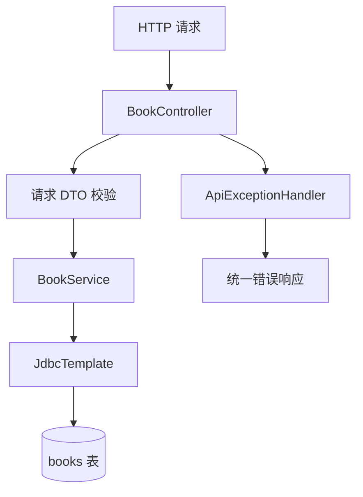

# 17｜Spring Boot REST API 实战

> 配套项目：[Spring Boot 图书 REST API](../Practice/springboot-library-api/README.md)  
> 基线：JDK 17、Spring Boot 3.4.4、Spring Web、Bean Validation、Spring JDBC、H2、JUnit 5。

## 1. 从 HTTP 请求到数据库

REST API 将资源通过统一的 HTTP 方法暴露给调用方。Controller 负责协议适配，Service 负责业务规则，Repository/DAO 负责持久化。本练习用 Spring 的 JdbcTemplate 直接承担数据访问，先把分层跑通，再考虑引入更完整的数据访问抽象。



## 2. REST 方法与状态码

| 操作 | HTTP 方法 | 路径 | 成功状态 |
|---|---|---|---|
| 查询列表 | GET | /api/books | 200 OK |
| 查询单本 | GET | /api/books/{id} | 200 OK |
| 新增 | POST | /api/books | 201 Created |
| 更新 | PUT | /api/books/{id} | 200 OK |
| 删除 | DELETE | /api/books/{id} | 204 No Content |

要点：
- GET 用于读取，不应产生业务副作用。
- POST 创建资源，通常返回 201 和新资源表示。
- PUT 表示按给定资源表示进行整体更新；局部更新可考虑 PATCH。
- 资源不存在时返回 404，输入不符合约束时返回 400。
- 不要把所有失败都返回 200；HTTP 状态码是 API 契约的一部分。

## 3. DTO 与输入校验

请求 DTO 与数据库模型分开，避免客户端直接决定数据库字段。练习中的 `BookRequest` 使用 `@NotBlank`、`@Size`、`@NotNull` 和 `@DecimalMin` 校验书名、作者与价格。

校验分两层：
1. **请求边界校验**：必填、长度、格式、数值范围。
2. **业务规则校验**：例如 ISBN 是否重复、库存是否足够、当前状态是否允许归还。

数据库约束仍然必要，因为并非所有数据写入都一定经过 HTTP Controller。

## 4. JdbcTemplate 与参数化 SQL

使用占位符传递参数，不要通过字符串拼接把用户输入放进 SQL。新增记录时通过 `GeneratedKeyHolder` 读取数据库生成的主键，避免把特定数据库的返回语法写死。

```java
KeyHolder keys = new GeneratedKeyHolder();
jdbc.update(connection -> {
    PreparedStatement ps = connection.prepareStatement(
        "INSERT INTO books(title, author, price) VALUES (?, ?, ?)",
        new String[]{"id"});
    ps.setString(1, request.title().trim());
    ps.setString(2, request.author().trim());
    ps.setBigDecimal(3, request.price());
    return ps;
}, keys);
```

生产代码还需考虑数据库方言、索引、分页方式、连接池、迁移工具以及异常分类。

## 5. 事务边界

`@Transactional` 应放在 Service 层的业务操作边界，而不是机械地加在每个方法上。当前 CRUD 写操作大多只有一条 SQL，事务的价值会在“更新库存 + 新增借阅记录 + 写入审计”这类多语句业务中更明显。

- Spring 默认通过代理管理声明式事务；同类内部自调用可能绕过代理。
- 默认运行时异常会触发回滚；检查型异常需要显式配置回滚规则或转换异常。
- 事务方法应由 Spring 管理的 Bean 调用。
- 不要在事务中执行耗时的外部网络调用，避免长时间占用数据库连接和锁。

## 6. 统一错误响应

`@RestControllerAdvice` 可以集中处理异常，避免 Controller 到处重复 try/catch。练习使用 Spring 的 `ProblemDetail` 表达错误状态与详情。

错误响应应提供足够的定位信息，但不要向客户端暴露 SQL、堆栈、密码或内部基础设施细节。生产服务通常还会增加稳定的错误码、请求追踪 ID 和结构化日志。

## 7. 测试策略

配套 `BookControllerTest` 使用 MockMvc 发出 HTTP 请求，不需要启动真实端口。覆盖：
- 新增、查询、更新、删除完整流程；
- 字段校验失败返回 400；
- 不存在的 ID 返回 404。

后续可以分层增加：
- Service 单元测试：业务分支与边界；
- Repository/DAO 集成测试：SQL、约束与事务；
- API 集成测试：状态码、JSON 契约、错误处理；
- 目标数据库测试：验证 H2 与生产数据库在 SQL、锁和隔离级别上的差异。

## 8. 动手练习

- [ ] 新增按书名关键字搜索接口，并对输入长度进行限制。
- [ ] 为列表增加分页与排序；限制最大 page size。
- [ ] 增加 ISBN 字段与唯一约束，测试重复 ISBN。
- [ ] 把 H2 配置改为环境变量驱动，并将敏感配置留在环境中。
- [ ] 为 400、404、409 定义稳定的错误码。
- [ ] 给 Service 写测试，验证失败时数据库没有留下半完成状态。

## 9. 面试自测

1. Controller、Service、DAO 分层分别解决什么问题？
2. DTO 与数据库实体为什么不应该无条件复用？
3. POST 与 PUT 的语义区别是什么？
4. 为什么要用参数化 SQL？它如何降低 SQL 注入风险？
5. `@Transactional` 在哪些情况下可能没有生效？
6. 400、404、409、500 分别适合表达什么问题？
7. 为什么 H2 测试通过不代表生产数据库行为完全一致？
